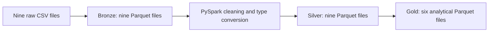
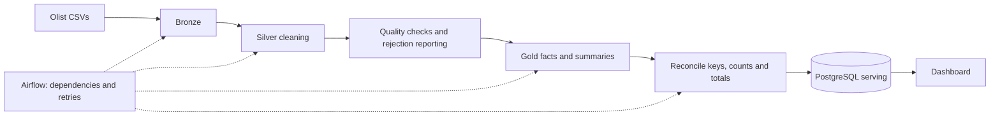

# Olist data engineering project — reference guide

Updated: 14 November 2026. This document replaces the old audit, architecture,
roadmap and 15-day plan. It describes the Olist project, separates working code
from planned features, and gives an ordered path to completion.

## 1. Objective

Build a reproducible local data pipeline that turns nine Olist e-commerce CSVs
into reliable analytical tables and, eventually, a dashboard. Use the project to
practice ingestion, PySpark transformations, relational modeling, data quality,
SQL, orchestration and testing.

The business questions are:

- How do sales and order counts change each month?
- Which product categories and sellers generate the most item sales?
- How long do deliveries take, and how often are they late?
- How do review scores relate to delivery performance?
- Where are customers and sellers located?

The supplied data is a static snapshot. This project currently runs locally;
it does not demonstrate a live feed or cluster-scale processing. The former
Supermart dataset, profit metrics and discount metrics are outside this design.
Olist does not provide product costs from which to calculate profit.

## 2. Current position

**You have a working Bronze → Silver pipeline. Your next milestone is validated
Silver, followed by Olist Gold models.** This corresponds roughly to Day 7 of the
previous schedule, with some earlier infrastructure requirements still pending.
A day number is a work sequence, not proof every preceding requirement is done.

| Capability | Actual status |
|---|---|
| Read all nine Olist CSVs | Implemented |
| Preserve Bronze fields as strings | Implemented |
| Persist Bronze and read it before Silver | Implemented |
| Clean all nine tables with PySpark | Implemented |
| Single Parquet file per table in each layer | Implemented |
| Tiny-fixture end-to-end integration test | Implemented; last run passed |
| Full source Bronze/Silver run | Succeeded; counts recorded below |
| Required-column contracts, key and reference checks | Pending |
| Rejection reports/quarantine and run metrics | Pending |
| ZIP-level geographic lookup | Pending; needed if joining coordinates |
| Olist Gold facts and summaries | Six tables built and saved by the pipeline; full-source validation pending |
| Ingestion ledger, source hashes and incremental updates | Pending |
| Airflow, PostgreSQL publication and dashboard | Pending |
| Docker Compose and GitHub Actions | Pending |
| Delta Lake | Not used; separate future storage decision |

`src/Gold.py` now includes `create_sales_monthly(orders, order_items)`, which returns
delivered-order monthly item revenue and freight after aggregating items by order.
It uses an inner join, excluding orders without items; orders must have unique IDs.
It returns a DataFrame and does not save or display it. Use `write_parquet_file`
from `main.py` when saving to preserve the single-file layout.

The module also builds `fact_orders`, `fact_order_items`, `sales_by_category`,
`seller_performance`, and `delivery_review_monthly`. `transform_gold_data(tables)`
returns all six Gold DataFrames from a dictionary of Silver tables. `main.py`
reads saved Silver tables and persists all six outputs under `Gold/`.

Facts preserve orders/items through left joins and require unique dimension keys.
Item, payment and review rows are separately aggregated before joining orders;
missing children leave null measures. All sales summaries include delivered orders
only. Category labels fall back from English to Portuguese to `unknown`. Review
scores are averaged within each order, then equally across scored delivered
orders in the monthly summary. Late rate excludes missing late flags; delivery
duration excludes null durations. Category/seller distinct order counts are not
additive. Small tests cover joins, sales filters and metric populations;
full-source key and total validation remains pending.

## 3. Architecture

### Implemented flow



### Planned completion flow



Python and PySpark implement transformations. Local Parquet is the current
storage format. PostgreSQL will serve analytical results; Airflow will run tested
commands in order. Docker Compose and CI will make execution reproducible.
These latter components are planned, not installed capabilities of this project.

### Storage decision: single files

Each table is a real file, for example `data/Bronze/customers.parquet` and
`data/Silver/customers.parquet`. This follows the chosen simple local layout.
Spark first writes into a temporary directory using `coalesce(1)`; the writer
moves its single part file to the requested filename and removes temporary files.
One output partition is suitable for this exercise but limits write parallelism.

Every run replaces the named output files. It does not append records. Successful
full reruns therefore replace snapshots rather than accumulate duplicates, but
this is not incremental ingestion, an ingestion ledger or an upsert demonstration.
Writes across multiple tables are not one transaction: a failed run can leave a
mixture of old and new outputs. Unrelated output files are not automatically removed.

Delta Lake needs table directories containing data files and a transaction log.
A `.parquet` filename is not Delta. If Delta MERGE and version history become
required, introduce a separate directory layout and compatible runtime deliberately.
The original Delta acceptance criteria remain deferred while using single files.

## 4. Repository map

| Path | Responsibility |
|---|---|
| `main.py` | CLI, Spark lifecycle, single-file writer, Bronze/Silver/Gold execution |
| `src/Bronze.py` | Nine source filenames, missing-file check, CSV loading |
| `src/Silver.py` | Common cleaning and one transform per table |
| `src/Gold.py` | Six Olist Gold builders and a dictionary orchestrator |
| `tests/test_pipeline.py` | Small end-to-end fixture and cleaning assertions |
| `data/raw/` | Original nine CSVs; preserve these inputs |
| `data/Bronze/` | Raw-value Parquet snapshots |
| `data/Silver/` | Cleaned, typed Parquet snapshots |
| `data/Gold/` | Six Olist analytical Parquet outputs |
| `sql/create_tables.sql` | Placeholder for future serving table definitions |
| `sql/queries.sql` | Placeholder for future analytical queries |
| `notebooks/exploration.ipynb` | Separate exploration; not part of pipeline execution |
| `docs/olist_data_profile.json` | Recorded source profile; reference, not a live quality gate |

Paths proposed later, such as `airflow/dags/`, `compose.yaml` and
`.github/workflows/ci.yml`, should be created when their milestones start.

## 5. Tables, grains and relationships

A table's grain means what one row represents. Establish this before joining.

| Table | Row represents / expected key |
|---|---|
| customers | Customer record linked to an order; `customer_id` |
| orders | One order; `order_id` |
| order_items | One item within an order; `(order_id, order_item_id)` |
| order_payments | One payment entry; `(order_id, payment_sequential)` |
| order_reviews | Review record; do not assume `review_id` or `order_id` is unique |
| products | One product; `product_id` |
| sellers | One seller; `seller_id` |
| geolocation | Geographic observation; ZIP prefix is not unique |
| category_translation | Category mapping; `product_category_name` |

Relationships:

- `orders.customer_id` → `customers.customer_id`.
- `order_items.order_id` → `orders.order_id`.
- `order_items.product_id` → `products.product_id`.
- `order_items.seller_id` → `sellers.seller_id`.
- Payments and reviews link to orders through `order_id`.
- Products link to translations through `product_category_name`.
- Customer and seller ZIP prefixes can link to a future one-row-per-ZIP lookup.

Use `customer_unique_id` for repeat-customer analysis. It is different from the
`customer_id` used to connect orders. Aggregate items, payments and reviews
separately to order grain before combining them in an order fact. Direct joins
between these one-to-many tables can multiply rows and inflate money totals.
Never join raw geolocation directly to transactions by ZIP.

## 6. Current transformations

Bronze reads headers without schema inference, preserves values as strings,
supports multiline quoted reviews and fails on malformed CSV input. It checks
that all source files exist. It does not yet enforce expected columns or add lineage.

All Silver transforms clean header names, trim ordinary strings, turn blank
values into nulls and remove exact duplicate rows. Nonblank review comments keep
their original prose and line breaks. Duplicate business keys are not resolved.

| Table | Additional Silver behavior |
|---|---|
| customers / sellers | Lowercase cities, uppercase states, preserve ZIP strings |
| orders | Parse five timestamps; normalize status; add purchase date/year/month, delivery days and late flag |
| order_items | Integer item sequence, decimal price/freight, shipping timestamp, `item_total` |
| order_payments | Integer sequence/installments, decimal payment value, normalized payment type |
| order_reviews | Integer score and parsed review timestamps; retain missing comments |
| products | Correct `lenght` header typos, integer measurements, volume in cm³, left join English categories |
| geolocation | Double coordinates and normalized city/state; exact duplicate removal |
| category_translation | Normalize labels; conflicting category mappings stop the product join |

Money uses `decimal(18,2)`. Invalid numeric/date strings become null through
`try_cast` and `try_to_timestamp`; they are not currently reported separately.
Missing delivery dates do not cause orders to be dropped. Late delivery compares
actual and estimated calendar dates and remains null when a date is missing.
Delivery days are calendar-day differences. Source timestamps have no timezone;
the CLI uses a UTC Spark session for consistent interpretation.

## 7. Verified output baseline

These counts were read from the generated Parquet files after the successful
full run on 14 November 2026. They are a reference for this input snapshot.

| Table | Bronze rows | Silver rows |
|---|---:|---:|
| customers | 99,441 | 99,441 |
| orders | 99,441 | 99,441 |
| order_items | 112,650 | 112,650 |
| order_payments | 103,886 | 103,886 |
| order_reviews | 99,224 | 99,224 |
| products | 32,951 | 32,951 |
| sellers | 3,095 | 3,095 |
| geolocation | 1,000,163 | 738,332 |
| category_translation | 71 | 71 |

All 18 outputs were readable, with no remaining table subfolders. The geolocation
count decreased through exact duplicate removal. This does not make ZIP unique.

The recorded source profile also highlights repeated review IDs, optional missing
comments, missing product categories, untranslated categories and missing delivery
dates even for a few delivered orders. Treat these as rules to investigate, not
reasons to delete all affected rows. The profile is historical evidence; rerun
checks when inputs change. Source provenance, licensing and currency attribution
still need to be recorded from the dataset's authoritative source.

## 8. Run and verify

From the repository root, using an activated compatible Python environment:

```bash
pip install -r requirements.txt
python main.py --master 'local[2]'
python -B -m unittest discover -s tests
```

Custom locations:

```bash
python main.py --input-dir /path/to/csvs --output-dir /path/to/output --master 'local[2]'
```

For the existing local virtual environment:

```bash
SPARK_LOCAL_IP=127.0.0.1 .venv/bin/python -B main.py --master 'local[2]'
SPARK_LOCAL_IP=127.0.0.1 .venv/bin/python -B -m unittest discover -s tests
```

`SPARK_LOCAL_IP` was used to work around this machine's hostname-resolution issue.
Spark also needs permission to open local sockets. Java 17+ is the documented
starting requirement; choose Python/Java versions compatible with the selected
Spark release. Dependencies currently specify `pyspark>=3.5,<5`, rather than a
pinned reproducible stack. Pin and verify an exact runtime during packaging.

Read a result using Spark:

```python
orders = spark.read.parquet('data/Silver/orders.parquet')
orders.select('order_id', 'purchase_date', 'delivery_days').show(5)
```

The existing unittest creates small samples using the raw source headers. It
checks real-file outputs, basic cleaning, ZIP zeros, decimal item totals,
missing delivery dates, unknown categories, invalid measurements, multiline
reviews and geolocation duplicates. It does not prove full-source key integrity,
Gold correctness, recovery, database publication or CI reproducibility.

## 9. Next milestone: finish Silver validation

Do this before trusting Gold totals. Suggested additions are a small
`src/quality.py` module and targeted tests; avoid a large framework initially.

- Declare required source columns and intended output types for each table.
- Validate required IDs, expected unique keys and references between tables.
- Check prices/freight/payments are nonnegative and review scores are 1–5.
- Distinguish invalid casts from permitted source nulls using Bronze values.
- Define delivery-date rules by order status; retain legitimate incomplete orders.
- Investigate repeated reviews and define an explicit order-level review policy.
- Give category displays a fallback: English label, source label, then unknown.
- If coordinates are needed, build a deterministic one-row-per-ZIP lookup and
  document coordinate aggregation and conflicting city/state handling.
- Write a report with input, accepted, rejected and duplicate counts. Preserve
  rejected rows with reason codes; distinguish warnings from fatal failures.

**Finish line:** every table has a documented grain and key rule; failures are
visible; all input rows are accounted for; planned joins preserve expected counts.
Do not enforce every observed source anomaly as a rejection without a business rule.

## 10. Gold implementation plan

The builders below are implemented in `src/Gold.py` and called by `main.py`
after reading persisted Silver. Full-source key and total validation remains pending:

| Output | Grain | Main contents |
|---|---|---|
| fact_orders | One row per order | Customer/state, status, dates, separately aggregated item/freight/payment totals and documented review summary |
| fact_order_items | One row per `(order_id, order_item_id)` | Product/category, seller, item price and freight |
| sales_monthly | Purchase year/month | Eligible orders, item sales, freight and clearly defined AOV |
| sales_by_category | Category | Item sales, item count and distinct orders |
| seller_performance | Seller | Item sales, item count and distinct orders |
| delivery_review_monthly | Purchase year/month | Eligible deliveries, late rate, delivery duration and review measures |

Choose three to five useful summaries initially; facts can support several
summaries without introducing every possible dashboard table.

Metric rules to settle before implementation:

- Item sales = sum of item `price`; freight is a separate measure.
- `item_total` = price + freight. Payment value is another measure, not extra sales.
- Document included order statuses for each sales metric. Show canceled/unavailable
  orders separately or state their inclusion explicitly.
- Define AOV using the same eligible population for numerator and denominator.
- Late rate uses eligible delivered orders with actual and estimated dates.
- State whether review averages are per review or per order; multiple reviews
  require a deterministic policy. State the tie-breaker if selecting one review.
- Preserve orders without items, payments or reviews when building the order fact,
  and define null-versus-zero behavior instead of silently discarding them.
- Reconcile item/freight/payment measures separately. Investigate differences;
  do not assume payment totals must equal item-plus-freight totals for every order.
- Distinct order counts by category or seller are not additive across groups.
- Use decimal money and safe division. Do not publish profit or discount KPIs.

**Finish line:** fact keys are unique; joins do not inflate rows; all sales totals
reconcile to the same eligible Silver population; metric filters are documented.

## 11. Remaining implementation sequence

| Stage | Work | Completion evidence |
|---|---|---|
| A — Current foundations | Align this guide with code; declare schemas, pin runtime, add source/batch metadata and useful logs | Reproducible startup, contracts and source counts |
| B — Silver validation | Complete Section 9 | Quality report and meaningful tests pass |
| C — Gold | Complete Section 10 | Validated facts and summaries from full source |
| D — Orchestration | Wrap tested commands in an Airflow DAG; add retries, timeouts, shared paths and `max_active_runs=1` | Complete manual run; a failed check blocks publication |
| E — Replay and recovery | Add source hashes/manifest, unchanged-input handling and correction fixtures | Reruns preserve totals; failure/retry has documented behavior |
| F — Serving and dashboard | Add PostgreSQL DDL/queries; stage, validate and publish in a transaction; build a small dashboard | Dashboard matches Gold; failed publication retains prior results |
| G — Reproducibility | Complete Docker Compose, tiny-fixture CI, setup/restart instructions and failure demo | Clean setup, CI and restart succeed |
| H — Portfolio handoff | Data dictionary, source attribution, diagram, results, screenshots and short demo | Another reader can run and explain the project |

Introduce tests and minimal Docker configuration alongside development. CI and
packaging completion do not mean waiting until the final stage to start them.
During recovery work, distinguish snapshot replacement from incremental updates.
If true MERGE/upserts and table history are required, make the Delta storage
migration a specific additional milestone before claiming those guarantees.

JSON/API adapters, a seeded operational database and simulated updates are later
extensions, not prerequisites for the first CSV-to-dashboard version. Label any
simulated sources honestly and avoid counting replayed orders as new business.
Defer Kafka, Kubernetes, MinIO, Trino, dbt and Prometheus/Grafana until a concrete
need justifies them. No ML training is required for this project.

## 12. Definition of a finished project

- [ ] All nine source files have documented schemas, grains and row accounting.
- [ ] Bronze and Silver run reliably with the chosen single-file layout.
- [ ] Invalid rows and quality failures have visible explanations.
- [ ] Olist Gold facts and useful summaries pass key/join/total checks.
- [ ] Metric definitions, order-status filters and missing-value rules are explicit.
- [ ] Reruns and a forced failure/retry have been demonstrated.
- [ ] Airflow runs the tested pipeline and exposes failures.
- [ ] PostgreSQL and one dashboard agree with validated Gold outputs.
- [ ] An exact runtime, Docker setup and restart procedure are verified.
- [ ] Meaningful small tests pass in CI without personal credentials.
- [ ] Source attribution, limitations, data dictionary and demo are complete.

**Immediate next action:** implement the Silver validation rules in Section 9.
Then implement Olist Gold. Update this guide whenever a planned capability becomes
implemented, and record the evidence rather than only checking a box.
