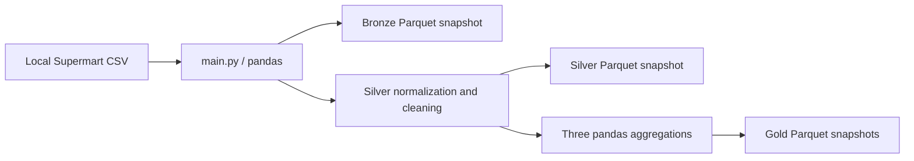

# Repository audit

Audit date: 2026-10-26. Scope: application source, notebook cells, raw CSV, all five Parquet artifacts, dependency declarations, SQL placeholders and Git state. No packages installed, containers launched, pipeline outputs rewritten or implementation files changed. Existing virtual environment used for read-only profiling and in-memory function verification. No applicable AGENTS.md found.

## Current architecture and evidence

`main.py` executes immediately on import, using working-directory-relative paths and a sys.path modification. It reads the CSV through `src/Bronze.py`, persists Bronze, passes the same in-memory DataFrame to `src/Silver.py`, persists Silver, then calls `src/Gold.py`. Downstream stages do not read the persisted upstream artifacts. Layers are full snapshots; this is a small pandas medallion-style batch project, not yet a Delta Lakehouse.

| Location | Actual responsibility / finding |
|---|---|
| `main.py` | Sequential CSV-to-Parquet batch driver; prints frames and counts |
| `src/Bronze.py` | pandas read_csv; catches all exceptions, prints and returns None |
| `src/Silver.py` | Lowercase/underscore headers; mixed-date parsing; six calendar attributes; exact-row deduplication; drops null date, ID and name |
| `src/Silver.py:load_silver_data` | Parquet reader exists but is unused by main |
| `src/Gold.py` | Sales/profit sums, distinct orders, mean discount, margin and average order value by region, category, year/month |
| `data/raw/` | One CSV source; no JSON, API or operational database source |
| `data/Bronze/`, `data/Silver/`, `data/Gold/` | Five existing Parquet files; no Delta transaction logs |
| `notebooks/exploration.ipynb` | Exploratory pandas work on only the first 1,000 rows; numpy/matplotlib imports beyond requirements; converts dates to strings then calls .dt, so sequential execution is inconsistent |
| `sql/create_tables.sql`, `sql/queries.sql` | Empty placeholders (one newline in create_tables); no schema or analytics SQL |
| `README.md` | Empty |
| `requirements.txt` | pandas and pyarrow, unpinned |
| `.venv/` | Existing local Python 3.14.4 environment; not a reproducible runtime contract |

## Verification and actual data

Raw: **9,994 rows, 11 columns**, zero null cells, zero exact duplicate rows, 9,994 unique order IDs. Current Silver: **9,994 rows, 17 columns**. Gold: **5 region rows, 7 category rows, 48 monthly rows**. In-memory execution of existing Silver and all three Gold functions exactly matched stored Parquet DataFrames. This establishes functionality for this input and environment only; it is not an automated test suite or a clean-environment deployment test. Main was inspected rather than executed to avoid rewriting artifacts.

Source columns: `Order ID`, `Customer Name`, `Category`, `Sub Category`, `City`, `Order Date`, `Region`, `Sales`, `Discount`, `Profit`, `State`. There are 50 distinct customer names, 7 categories, 23 subcategories, 24 cities, 5 region labels, and one state (Tamil Nadu). Each subcategory maps to one category in this sample. Names occur across up to 24 cities and are not trustworthy customer identifiers. The North region contains only one row; flag distribution imbalance without silently correcting geography.

Current parser date range: 2015-01-02 through 2018-12-30. Raw dates mix slash and hyphen strings. Using mixed-format day-first versus month-first parsing changes **3,683 rows**. Neither interpretation is established as source truth. Global totals remain sales **14,956,982** and profit **3,747,121.20**, while monthly and calendar outputs depend on that choice. Currency, whether sales are already discounted, provenance/license and date conventions are undocumented.

## Implementation status

| Capability | Classification | Evidence / limit |
|---|---|---|
| CSV ingestion, pandas transforms, Parquet outputs | Implemented and verified for supplied dataset | Existing functions and matching artifacts |
| Medallion organization | Partially implemented | Named directories and sequential transformations; no independent storage contracts or ACID |
| Data quality | Partially implemented | Exact duplicates and three null fields handled; no metrics, tests or quarantine |
| Error handling / logging | Partially implemented | Print statements; read errors become None and fail later |
| SQL / database serving | Placeholder only | Empty SQL files; no database configuration or connector |
| Notebook exploration | Partially implemented | Sample only; date/string execution-order issue |
| Spark, Delta, Airflow, Docker, Compose, PostgreSQL, dashboard | Missing; requested target only | No implementation or configuration found |
| API/JSON ingestion, incremental extraction, MERGE, watermarks | Missing; requested target only | Single full-file loader |
| Pytest, CI, structured logs, monitoring, configuration | Missing | No test suite, workflow, .env template or config module |
| MinIO, dbt, Kafka, Prometheus/Grafana | Not implemented or documented as existing plans | Optional candidates from requested target |

No technology can be classified as a documented repository plan merely from the request: README is empty and requirements names only pandas/pyarrow.

## Gaps ordered by consequence

1. Establish date semantics before treating monthly analytics as reliable. Preserve raw values and record any approved ambiguity policy.
2. Make failure explicit: returning None hides ingestion errors; current partial writes can leave inconsistent layer snapshots.
3. Define schemas and business keys: drop_duplicates does not resolve conflicting versions of one order ID. Numeric validation, empty strings, invalid categories and safe division are absent. pandas mutation also changes the upstream in-memory DataFrame.
4. Add lineage and replay boundaries: no batch IDs, content hashes, source version, extraction timestamps, checkpoints or historical snapshots. Full overwrites do not prove safe incremental retries.
5. Replace floating-point money with explicit decimals in the target; document rounding and KPI meanings. No evidence supports quantity, product-level or customer-identity analytics.
6. Add meaningful tests and runnable commands before migrating. Pin a compatible Python/Java/Spark/Delta stack after a compatibility smoke test; current Python 3.14 must not be assumed compatible.
7. Separate entry point, configuration and transformations; add orchestration, serving and observability incrementally.
8. Git already contains user modifications to main.py, requirements.txt and Silver.py, deleted tracked CSV outputs, new untracked Parquet outputs and modified tracked bytecode. Preserve all. Future approved cleanup should add ignore rules and deliberately decide which small reproducible samples to track; do not erase current work.

## First concrete task, after architecture approval

Create a baseline contract and regression fixtures for the existing pandas pipeline: enumerate the 11 source fields, preserve the current parser as legacy behavior, document ambiguous-date examples, verify totals and existing aggregate schemas, and inject missing IDs, conflicting duplicate IDs and invalid dates. Do not silently settle date semantics or migrate storage during that task. See the target architecture and phased roadmap for subsequent work.
