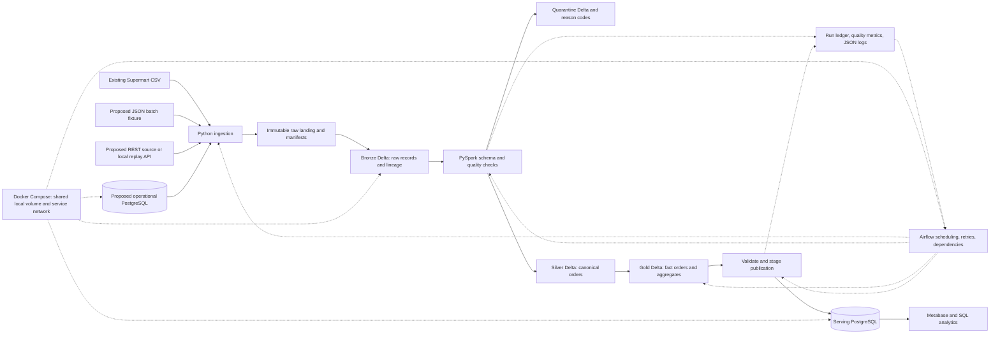

# Proposed local Lakehouse architecture

Status: design for approval; nothing in this document is implemented by this audit. Preserve the working pandas path while building and validating its Spark replacement. Goal: a reproducible portfolio system with production practices, without claims of high availability or demonstrated large-scale throughput.

## Flow and operating model



Start with CSV → local Spark → Delta Bronze/Silver/Gold → validation. Use Spark local mode with two worker threads initially: exercises distributed APIs but does not prove cluster scale. No separate Spark cluster, broker or object store is needed for 9,994 records. Store unpartitioned Delta tables on a shared local volume initially; avoid thousands of small partitions. Keep raw CSV and legacy Parquet outputs separately from new Delta directories. Delta files include a transaction log; renaming a Parquet file does not create Delta.

Next add Airflow with a local executor and Spark available in its task runtime, shared volume paths and compatible Java/Python dependencies. Choose one supported Airflow version and its corresponding service topology during implementation. Use one PostgreSQL service locally with separate databases and least-privilege roles for Airflow metadata, operational demo data, serving data and Metabase metadata. This saves memory but shares a failure domain; source and serving remain logically separate. Metabase can be an optional Compose profile. Measure RAM/CPU and document actual prerequisites before claiming one-command reproducibility.

Airflow dependencies: ingest → Bronze → Silver validation/quarantine → Gold → Gold checks → publish. Add bounded transient retries, execution timeouts, max_active_runs=1 and per-table writer serialization. A failure must stop downstream publication and propagate a clear exception. Never pass DataFrames through XCom: pass run IDs, manifest paths and committed table versions. Schedule static file scans manually first; enable a daily demo schedule only when new source batches exist. Backfills receive explicit source snapshot and interval parameters; do not filter historical demo records against today's date.

## Recommended directory layout

Existing case-sensitive data directories remain. New source subpackages can be added beside current modules; retire legacy entry points only after regression acceptance and explicit implementation work.

```text
.
├── main.py                         # preserve legacy runner initially
├── README.md                       # setup, evidence and limitations
├── requirements.txt                # pinned application dependencies
├── pyproject.toml                  # package/test/lint configuration
├── .env.example                    # names and safe defaults, no secrets
├── .gitignore
├── compose.yaml
├── src/
│   ├── Bronze.py / Silver.py / Gold.py  # existing modules during migration
│   └── lakehouse/
│       ├── ingestion/              # file, JSON, HTTP, PostgreSQL adapters
│       ├── processing/
│       │   ├── bronze/             # source envelope to Delta
│       │   ├── silver/             # parsing, canonicalization, MERGE
│       │   └── gold/               # fact and aggregate construction
│       ├── quality/                # rules, quarantine and metrics
│       ├── serving/                # staged transactional publication
│       └── common/                 # config, Spark session, logging, ledger
├── config/                         # versioned source/schema/rule contracts
├── data/
│   ├── raw/                        # preserve current CSV
│   ├── Bronze/ / Silver/ / Gold/    # preserve current Parquet artifacts
│   ├── landing/                    # immutable captured batches
│   └── lakehouse/                   # bronze, silver, gold, quarantine Delta
├── airflow/dags/                   # thin orchestration definitions
├── sql/
│   ├── create_tables.sql           # existing placeholder → serving DDL
│   ├── queries.sql                 # existing placeholder → KPI SQL
│   └── source/                     # proposed operational seed/schema
├── tests/
│   ├── unit/                       # pure rules and transform contracts
│   ├── integration/                # Delta replay and database publication
│   └── fixtures/                   # tiny deterministic source variants
├── docker/                         # runtime Dockerfile and init scripts
├── scripts/                        # explicit CLI, demo and smoke commands
├── notebooks/                      # reuse exploration; consume Gold
├── monitoring/                     # metric contracts and inspection SQL
├── docs/                           # audit, design, roadmap, runbook, results
└── .github/workflows/               # tests and integration CI
```

Generated large data, logs, secrets and environments should be ignored after approved Git cleanup. Keep small test fixtures and source licensing metadata versioned.

## Technology decisions

| Technology | Purpose | Existing status | Priority | Justification |
|---|---|---|---|---|
| Python + pandas | Ingestion, legacy reference | Working | P0 | Preserve baseline; pandas need not process target lake tables |
| CSV / Parquet | Current input and reference outputs | Working | P0 | Existing data and migration comparison |
| PySpark | Typed distributed transformation APIs | Missing | P0 | Main learning objective; local mode fits hardware |
| Delta Lake | Transactional tables, MERGE, versions | Missing | P0 | Demonstrate ACID and retryable table writes |
| JSON / REST / PostgreSQL source adapters | Multi-source extraction | Missing | P1 | Add after CSV end-to-end slice; all required for completed target |
| Airflow | Scheduling and task recovery | Missing | P0 | Thin DAG around tested commands |
| Pytest | Rule, replay, integration verification | Missing | P0 | Evidence for correctness |
| PostgreSQL serving | Analytical SQL publication | SQL placeholders only | P0 | Small and accessible dashboard serving layer |
| Metabase | Dashboard | Missing | P1 | Lightweight optional startup profile |
| Docker / Compose | Reproducible runtime | Missing | P0 | Start minimal Spark image early, integrate services later |
| Git / GitHub Actions | Versioning and CI | Git exists; CI missing | P0 | Visible quality gates; GitHub remote/deployment not verified |
| Environment config / JSON logging / run metrics | Operations and diagnosis | Print statements only | P0 | Small explicit modules suffice |
| MinIO | S3-compatible object storage | Missing | P2 | Defer until an object-store exercise justifies added services |
| dbt | Analytical SQL modeling | Missing | P2 | Spark already owns Gold; consider only for substantial SQL marts |
| Kafka | Streaming | Missing | P2 | No real streaming requirement; exclude from initial architecture |
| Prometheus / Grafana | Metrics collection and graphs | Missing | P2 | Run ledger and inspection queries are sufficient initially |
| Kubernetes | Cluster orchestration | Missing | P2 | Excluded: unjustified for this local project |

P0 means essential foundation, P1 means recommended sequence after it, not omission from the requested final system. Exact versions must be pinned together after a Python/Java/Spark/Delta compatibility smoke test; no version selection or installation occurs here.

## Source-to-target model

Observed grain: one record per unique Order ID in this file. Proposed canonical key `(source_system, order_id)` prevents accidental collisions between independent systems. When multiple adapters replay the same underlying orders, assign the same logical source_system; keep adapter/extraction method separately. Do not union CSV and a seeded database as independent business facts. No order-line ID, quantity, SKU, customer ID, update timestamp, currency or actual streaming source exists.

| Actual source field | Silver target | Proposed type | Rule |
|---|---|---|---|
| Order ID | order_id | string | Required, trimmed, nonempty; key within source |
| Customer Name | customer_name | string | Required by current policy; display attribute, not customer identity |
| Category | category | string | Required; controlled source vocabulary |
| Sub Category | sub_category | string | Required; valid relationship to category |
| City | city | string | Required; trim, preserve labels |
| Order Date | order_date | date | Explicit documented formats; unresolved ambiguity flagged |
| Region | region | string | Required; observed labels, not inferred geography |
| Sales | sales | decimal(18,2) | Required, finite, >=0; currency unspecified |
| Discount | discount | decimal(7,6) | Required, 0..1; assumed fractional rate, verify source meaning |
| Profit | profit | decimal(18,2) | Required, finite; allow negative values |
| State | state | string | Required; do not infer country |

Bronze `source_records`: preserve the eleven original field names and lexical string values for CSV, plus original payload for JSON/API/database captures. Proposed technical extensions: source_system, adapter, source_uri, source_file_sha256, batch_id, record_ordinal, raw_payload, payload_hash, ingested_at (UTC), schema_version, source_updated_at (nullable). Use `(source_system, batch_id, record_ordinal)` as physical ingestion identity. Retain original files in landing for exact replay; order_date is not an extraction watermark.

Silver `orders`: eleven normalized typed fields above, plus existing derived order_year/month (integer), order_month_name (string), order_quarter (string Q1..Q4), order_day_name (string), is_weekend (boolean). Proposed lineage extensions: source_system, batch_id, payload_hash, ingested_at, source_updated_at, first_seen_at, last_changed_at and rule_version. Use UTC timestamps; calendar fields derive from a date, not a timezone conversion. Keep technical fields out of ordinary business views.

Quarantine: original record and lineage plus proposed rule_codes (array of strings), detected_at and rule_version. Stable key `(source_system, batch_id, record_ordinal, rule_version)` prevents retry duplication. Retain rejected data for correction and audited reprocessing.

Gold schemas and grains:

| Table | Grain / key | Columns |
|---|---|---|
| fact_orders | source_system + order_id | Silver business fields, lineage and source version; detailed EDA foundation |
| dim_date | order_date | Existing six derived calendar attributes; proposed deterministic date dimension |
| sales_by_region | region | Existing seven-column output: region, total_sales, total_profit, total_orders, average_discount, profit_margin, average_order_value |
| sales_by_category | category | Same metrics, keyed by category |
| sales_by_year_and_month | order_year + order_month | Same metrics, keyed by year/month |
| sales_daily | order_date + category + region | Proposed additional mart using existing attributes and same metrics |

Money sums use decimal(20,2), counts long, average_discount decimal(12,6), margin decimal(18,6), AOV decimal(20,2); explicitly round at the serving contract, and guard zero denominators with NULL. Existing four-decimal margin/discount display can remain a presentation view. Compute each ratio from sums, never average subgroup ratios. Distinct orders are not generally additive across arbitrary future grains. Average discount is record-weighted, not sales-weighted. Do not subtract discounts again without validating sales semantics.

Relationship model: date → orders (1:N); category → subcategory (1:N in sample); category/subcategory and geographic labels describe orders. City → state holds in this single-state file but is not a global business key. Prefer denormalized fact initially; no customer dimension or invented customer IDs. Names alone cannot support defensible customer retention/churn KPIs.

## Incrementality, transactions and recovery

- Files: hash immutable contents and persist a manifest. Process unseen hashes; identical content is a no-op. Changed snapshots receive new batches, with explicit snapshot precedence. For the supplied static source, full keyed reconciliation is more honest than pretending order_date is a change cursor.
- JSON and REST: proposed deterministic same-schema order fixtures and a local replay API seeded from the CSV, clearly labeled simulated sources. Add a real endpoint only after checking contract, licensing, authentication and useful business relevance. Independent real data stays in separate Bronze/Silver tables until a valid join exists. Support pagination, bounded timeout, backoff and persisted page/cursor state; archived responses permit offline runs. Advance cursor only after durable batch commit.
- Operational PostgreSQL: proposed seed of these same orders with explicitly added updated_at and monotonic change_version or stable tie-breaker. Extract a bounded window `(previous cursor, captured upper cursor]` under a consistent snapshot, with overlap and keyed deduplication. updated_at must be assigned reliably on change; arbitrary backdated updates cannot be guaranteed. Initial scope is inserts/updates; hard deletes need tombstones or periodic snapshot reconciliation, not an unsupported CDC claim.
- Silver: collapse identical key/payload records; quarantine conflicting keys within a batch unless a trusted source version supplies deterministic ordering. MERGE only one resolved row per key. Accept newer source versions, reject stale changes, avoid updating unchanged rows merely because ingestion time changed. Preserve first_seen_at. Validate business schema before merge; permit reviewed additive nullable evolution per operation, reject incompatible changes.
- Gold: recompute full small aggregates from a pinned Silver version first. Later optimize only affected old AND new groups when dates/categories change; additive appends would double count updates. Record input versions in a run ledger and publish only validated outputs.
- Delta guarantees are per table, not across all layers. Record each stage commit and reconcile ledger state after crashes. Serialize a writer per table and use stable batch keys so replay after a commit-before-checkpoint crash remains safe. A successful batch is not equivalent to a globally atomic pipeline.
- Serving: load run-specific staging tables, validate counts/totals, then replace/upsert all dashboard tables within one PostgreSQL transaction and update a publication run ID. Spark JDBC staging writes alone are not an atomic publication. Keep prior published data available on failure; clean abandoned staging by policy. Delta and PostgreSQL are not one distributed transaction: retries reconcile by run/version.

## Quality, logging and operational contracts

Fail a batch on missing required columns, incompatible schema, unreadable input or failed reconciliation. Quarantine row-level null/blank keys, invalid dates, invalid numeric casts, discount out of range and unresolved key conflicts. Do not reject negative profit automatically. Treat new categories, suspicious dates and region skew as explicit warning/review policies initially. Agree any rejection threshold before use; source null/duplicate counts of zero are a baseline, not proof future input is clean.

Metrics: batch/source/run IDs, input/accepted/rejected/duplicate counts, reason counts, inserted/updated/unchanged counts, layer versions, duration, bytes, retry count, source lag where meaningful, and publication status. Account for every input row once (accepted, rejected or deduplicated); sum reason counts can exceed rejected rows when one row violates several rules. Compare Gold totals to accepted Silver with explicit decimal rounding tolerance. Emit structured JSON with task/stage and exception context; avoid dumping customer payloads to logs. Store run/stage metrics in PostgreSQL control tables once available and JSON artifacts before that. Monitor Airflow failures, missed expected batches, rejection spikes and stale publication; static historical data does not imply current-source freshness. Provide failure/replay and volume-backup runbooks; no HA or SLA claims.

## Future Data Science readiness

Retain detailed fact_orders rather than only aggregates. Preserve immutable source batches and versioned Silver snapshots beyond a documented retention period: Delta time travel depends on retained data/log files and VACUUM policy. A current-state MERGE table alone is insufficient historical truth. Proposed append-only order_versions history uses source version, valid_from/valid_to and observed_at; only implement when genuine updates exist. Historical data before the first capture cannot be reconstructed from this CSV.

Any future feature table must declare grain, feature cutoff timestamp, event-time window, availability timestamp and input versions. Restrict features to events before cutoff AND observed by cutoff; future profit/outcome totals and post-cutoff corrections cannot enter historical features. Split datasets chronologically and fit preprocessing only on training data. Customer-level features require a reliable future customer identifier; aggregated sales forecasting is a more defensible initial extension. Currency, calendar assumptions, completeness and simulated-source provenance must be documented. No model training belongs in this implementation.

## Primary documentation informing design

- [Delta MERGE](https://docs.delta.io/delta-update/): resolve multiple source matches before merging.
- [Delta concurrency](https://docs.delta.io/concurrency-control/): transaction and conflict semantics are table scoped.
- [Delta batch writes](https://docs.delta.io/delta-batch/): use controlled schema evolution, with syntax checked against pinned versions.
- [Spark SQL types](https://spark.apache.org/docs/latest/sql-ref-datatypes.html): explicit date, timestamp and decimal contracts.

These references inform the proposal; they do not establish local installed capabilities. Version compatibility and runtime resources remain acceptance work.
